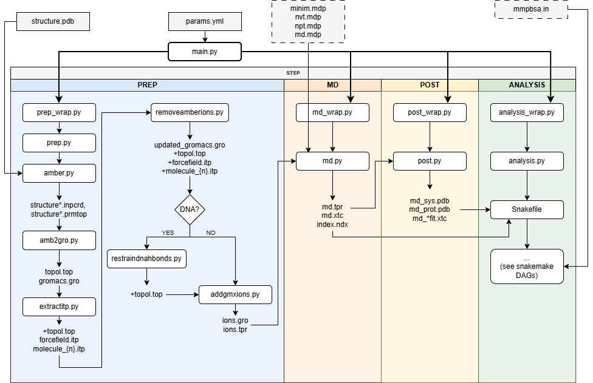
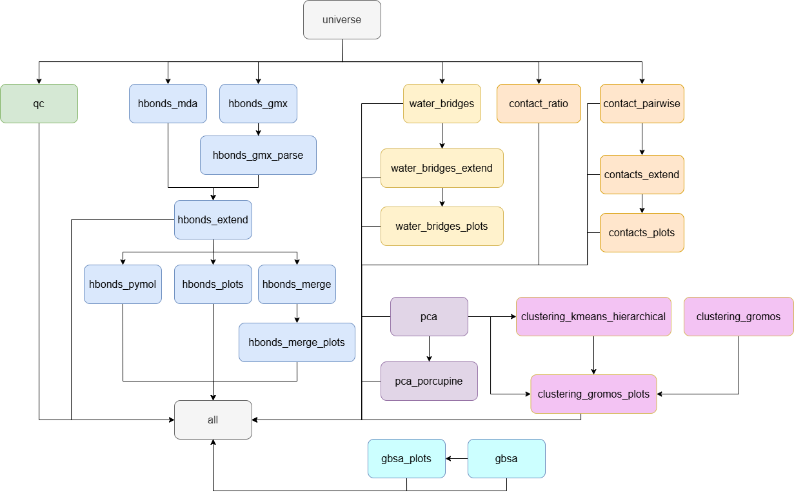

# Table of contents
- [Introduction](#introduction)
- [Installation](#installation)
  - [Dependencies](#dependencies)
- [Directory system](#directory-system)
- [Parameters](#parameter-file)
- [Modules](#modules)
  - [1. System preparation](#1-system-preparation)
  - [2. Molecular dynamics simulation](#2-molecular-dynamics-simulation)
  - [3. Post-processing](#3-post-processing)
  - [4. Analysis](#4-analysis)

# Introduction

This repository contains a pipeline to perform molecular dynamics (MD) simulations and analyze the results, with minimal setup and increased automation. It is particularly aimed at the study of protein-protein and protein-DNA systems and the effects of mutations, and specifically point mutations, on these complexes. Part of the analysis functionalities focus on these interactions; for example, looking at the interactions between protein chains or between the protein complex and the DNA.

The pipeline consists of four modules:

1. System preparation
2. Molecular dynamics simulation
3. Post-processing
4. Analysis



# Installation

Clone this repository to use it.

```git clone https://github.com/ivilaruriar/thesis_main.git```

For the moment, the pipeline is not available as an installable package. 

## Dependencies

The pipeline requires the following packages:
- Ambertools 
- Biopython 
- Dask
- GROMACS
- gmx-MMPBSA
- Matplotlib
- MD Analysis 
- MPI for Python (mpi4py)
- ParmEd 
- pdb-tools 
- PyMOL
- Snakemake 
- UMAP (umap-learn)

To create a conda environment with the required packages, run:

```
conda create --name pipemd ambertools biopython dask-core gromacs=2024.3 matplotlib mdanalysis mpi4py parmed pdb-tools pymol snakemake umap-learn 

conda activate pipemd

pip install gmx-MMPBSA --no-deps
```

An env.yml file is also provided to recreate the environment, running ```conda env create -f environment.yml```.

If you intend to use GPU for production MD, make sure there is a GROMACS version wit support for your GPU type installed and available.

# Directory system

The starting PDB structure must be placed within a directory system with these levels: 

```text
/
├── data/
│   ├── {structure}
│   │   ├── {mutation}
│   │   │   └── {prep}.pdb
```

The data/ directory can be placed within the root of the repository directory or outside of it.

From this initial directory system, the scripts generate the necessary directories to achieve this structure:

```text
/
├── data/
│   ├── {structure}
│   │   ├── {mutation}
│   │   │   ├── amber
│   │   │   ├── gromacs_common
│   │   │   ├── rep{i}
│   │   │   │   ├── analysis
│   │   │   │   │   ├── 000_raw/
│   │   │   │   │   ├── 001_qc/
│   │   │   │   │   ├── 002_hbonds_{sele1}_{sele2}/
│   │   │   │   │   ├── 003_pca/
│   │   │   │   │   ├── 004_contacts_{sele1}_{sele2}/
│   │   │   │   │   ├── 005_clustering/
│   │   │   │   │   └── 006_gbsa_{sele1}_{sele2}/
│   │   │   │   └── gromacs
```

# Parameter file

The majority of the parameters are passed through a YAML file named ```params.yml``` by default.  

A model of ```params.yml``` is provided to use as a template.

The following parameters are parsed from ```params.yml```:

| Parameter      | Type | Use                                                                                                         | Used in  | Compulsory |Default | Example        |
| :--------------| :--- | :-------------------------------------------------                        | :------  | :------| :------ |:------------- |
| pdbpath        | str  | Path of the starting .pdb file.                                           | prep, md, post, an | * |   
| repn           | list | List of replicates (int).                                                 | md, post, an | * |   [ ]   | [1, 2, 3]  |
| ffs            | list | List of Amber forcefields to use                                          | prep, an |        |         | [phosaa10, GLYCAM_06j-1] |
| dna            | bool | Specify if the system contains DNA.                                       | prep, md, post, an |        | False   | True  |
| phos           | bool | Specify if the protein contains phosphorilated residues.                  | prep, md, post, an |        | False   | True  |
| range_a        | str  | Range of residues in DNA chain A that are paired with chain B. 0 indexed. | prep |        | [0,-1] (full chain)  | [2,-1]  |
| range_b        | str  | Range of residues in DNA chain B that are paired with chain A. 0 indexed. | prep |        | [0,-1] (full chain)  | [2,-2]  |
| md_time: 2000  | int  | Duration of the MD production simulation in ps (overwrites md.mdp). If the MD was previously ran and did not reach this target duration, the simulation will be extended from the last checkpoint, independently of whether it was previously completed or not. Bear in mind that an md_time greater than the latest checkpoint will cause an error.       | md | | | 10000 | 20000 (for 20 ns) |
| em             | str  | Path to the .mdp file with custom energy minimization parameters          | md |        | None (use default) | myscripts/em.mdp |
| nvt            | str  | Path to the .mdp file with custom NVT equilibration parameters            | md |        | None (use default) | myscripts/nvt.mdp |
| npt            | str  | Path to the .mdp file with custom NPT equilibration parameters            | md |        | None (use default) | myscripts/npt.mdp |
| md             | str  | Path to the .mdp file with custom MD parameters                           | md |        | None (use default) | myscripts/md.mdp |
| ntmpi          | str  | Number of thread-MPI ranks to start for MD                                | md |        | 0 (Let GROMACS guess)  | 2  |
| ntomp          | str  | Number of OpenMP threads per MPI rank to start for MD.                    | md |        | 0 (Let GROMACS guess)   | 2  |
| ngpu           | str  | Number of GPUs to use for MD.                                             | md |        |                           | 2  |
| gputasks       | str  | List of GPU device IDs, mapping each task on a node to a device. Tasks include PP and PME (if present). | md |        | |"01" |
| nb             | str  | Calculate non-bonded interactions in MD on: auto, cpu, gpu. | md |        | auto (Let GROMACS guess.)   | gpu |
| pme            | str  | Perform PME calculations in MD on: auto, cpu, gpu.          | md |        | auto (Let GROMACS guess.)   | gpu |
| npme           | str  | Number of separate ranks to be used for PME in MD.          | md |        | -1 (Let GROMACS guess.)   | 1  |
| snakecores     | int  | Number of CPU cores to use for the analysis.                | an |        |     all    | 36 |
| methods_hbonds | list | Packages to use for hydrogen bond analysis: MDAnalysis and/or GROMACS. Values: gmx, mda. | an |        | [gmx, mda] | [mda]
| structure      | list | Structure(s) to analyze.                                       | an | * |  [ ]       | [1BF5, 1YVL] |
| muts           | list | Mutations or variants of the previous structures to analyze.   | an | * |     [ ]      | [WT, N460H] |
| start_frame    | int  | First frame to analyze in interaction analysis.                | an |        | 1 | 1000 |
| stop_frame     | int  | Last frame to analyze in interaction analysis.                 | an |        | None | 2001 |
| group1         | str  | First group of interest for interaction analysis, which studies the interaction between group1 and group2. These can be chain IDs (e.g., "A", "B", "C") or predefined groups (e.g., "Protein", "DNA")  | an (hbonds, contacts, water bridges) | * | | Protein |
| group2         | str  | Second group of interest for interaction analysis, which studies the interaction between group1 and group2. These can be chain IDs (e.g., "A", "B", "C") or predefined groups (e.g., "Protein", "DNA") | an (hbonds, contacts, water bridges) | * | | DNA |
| chaingroups    | dict | Named groups of chain lists. Used to group them together for plotting. | an |  |  | (See below)
| domains        | dict | Domains or segments of the protein. These are used for annotation and plotting. First level keys are group names, which must match chaingroup keys. Each domain is defined by: start (int), end (int), color (str), labe(str). Domains for the same chaingroup should not overlap, but can be adjacent.| an | | | (See below) |

Example 'chaingroups' definition:
```
chaingroups:
  Protein: [A, B]
  DNA: [C, D]
```


Example 'domains' definition:
```
domains:
  Protein:
    - start: 134
      end: 317
      color: blue
      label: CCD
    - start: 318
      end: 488
      color: red
      label: DBD
    - start: 489
      end: 576
      color: green
      label: LD
    - start: 577
      end: 683
      color: yellow
      label: SH2
  DNA:
    - start: 1
      end: 12
      color: green
      label: DNA_Domain1
    - start: 13
      end: 24
      color: orange
      label: DNA_Domain2
```

# Modules

The modules can be run sequentially through a single command or separatelly. The steps of the pipeline are sequencial, therefor before running a module the previous one should have been run for that particular structure or, alternatively, the necessary input files to execute a module, which are usually produced by the previous module, should be available.

To run the complete pipeline, from the repository root, run:
```
python -m scripts.main --params <params.yml path> --prep --md --post --analysis
```

## 1. System preparation

Preparation only needs to be run once per initial structure, that is, once per variant or mutation.
```
python -m scripts.main --params <params.yml path> --prep
```

It is recommended to visually inspect the starting .pdb structure to identify and correct any missing atoms, residues, or unresolved regions. If necessary, mutations can be added with software such as ChimeraX or PyMOL, selecting the mutated residue rotamers with the smallest number of clashes. Starting from this file, the preparation step outputs the structure and topology files of the complex in an octahedral solvate box with a padding distance of 10.0 Å, with neutral charge and Na+ and Cl- ionic concentrations of 0.15 M. 

Steps performed by this command:
- Force field setup and solvation with LeAP. The default forcefields are ff19SB for proteins, phosaa19SB for phosphorylated residues, OPC for water and bsc1 for DNA. 
- Conversion to GROMACS compatible files with ParmEd.
- Extraction of topology into one .itp file per chain or compound.
- Neutralization and target ionic concentration with GROMACS.
- Addition of distance restraints to prevent DNA unwrapping (if DNA is present).

## 2. Molecular dynamics simulation

```
python -m scripts.main --params <params.yml path> --md
```

Steps performed by this command:
1. Energy minimization (EM) to relax the structure, minimizing clashes and unfavorable interactions. 
2. NVT equilibration to reach the target temperature. Default: 300 K.
2. NPT equilibration to reach the target pressure. Default: 1 bar. 
3. Production molecular dynamics simulation. Default: 200 ns with 2 fs steps.

It is also possible to run energy minimization, equilibration (NVT and NPT) and production MD separately. This is particularly useful if you want to fine tune the parameters and check that the system is reaching stable target values before moving on to production MD, which requires more resources. The output includes plots of potential energy (for EM), temperature (for NVT), pressure and density (for NPT) across time, to help you assess if adjusting the parameters or applying longer minimization and/or equilibration times is necessary.

The commands for individual MD steps are:

```
# Energy minimization
python -m scripts.main --params <params.yml path> --md_em

# Equilibration (NVT and NPT)
python -m scripts.main --params <params.yml path> --md_eq

# Production MD
python -m scripts.main --params <params.yml path> --md_prod
```

These flags can be combined. Be aware that equilibration depends on the output of EM, and production MD relies on the results of equilibration. Therefore, running `--md_eq` without `--md_em` will result in an error, unless `--md_em` was previously run independently for that replicate.

For each step, .mdp configuration files are provided and used by default. It is possible to provide custom .mdp files for one or more steps to overwrite the defaults. The provided .mdp can be useful as templates.

## 3. Post-processing

```
python -m scripts.main --params <params.yml path> --post
```

This command re-wrapps the system within the simulation box and applying clustering to maintain the integrity of the complex, minimizing periodic boundary condition artifacts. It is recommended to visually inspect the structure and trajectory of the system after performing this step to confirm that artifacts are no longer present.

## 4. Analysis

To run the complete analysis (this will take some time depending on the system size and simulation time):

```
python -m scripts.main --params <params.yml path> --analysis
```

It is also possible to run one or more subsets of rules:
- Quality control (green): ```qc```. Including:
  - Root mean square deviation (RMSD). It quantifies the deviation of the structure from the reference structure over time and serves as a measure of structural stability. 
  - Root mean square fluctuation (RMSF). It quantifies the deviation of each particle from its average position over time, helping to identify the regions with greater mobility or flexibility.
- Hydrogen bonds (blue): ```hbonds```
- Contact and distance analysis (orange): ```contacts```. Includes:
  - Ratio of preserved native contacts (contacts present in the reference structure)
  - Pairwise distances
- Water bridges (yellow): ```wb```
- Principal component analysis (PCA, purple): ```pca```
- Clustering (pink): ```clust```. Includes:
  - Hierarchical clustering 
  - K-means clustering
- GBSA predicted free binding energy (light blue): ```gbsa```




Examples:
```
python -m scripts.main --params <params.yml path> --analysis --rules qc

python -m scripts.main --params <params.yml path> --analysis --rules hbonds contacts

python -m scripts.main --params <params.yml path> --analysis --rules pca clust

python -m scripts.main --params <params.yml path> --analysis --rules gbsa
```

Occasionally, if snakemake runs into an error during the analysis and it crashes, it will lock the directories it was working with, resulting in a recurrent error when the command is rerun. If this happens, verify that no parallel snakemake analysis is running on the locked directory or files, and unlock it with the following command:

```
python -m scripts.main --params <params.yml path> --analysis --rules <rules> --unlock
```

If the error persists, try removing the subdirectory with the analysis results that crashed, in case incomplete files are causing the error.