# Table of contents
- [Introduction](#introduction)
- [Installation](#installation)
  - [Dependencies](#dependencies)
- [Directory system](#directory-system)
- [Parameters](#parameter-file)
- [Modules](#modules)
  - [1. System preparation](#1-system-preparation)
  - [2. Molecular dynamics simulation](#2-molecular-dynamics-simulation)
  - [3. Post-processing](#3-post-processing)
  - [4. Analysis](#4-analysis)
    - [QC](#quality-control-rmsd-rmsf-and-radius-of-gyration)
    - [PCA](#principal-component-analysis-pca)
    - [Clustering](#clustering)
    - [Hydrogen bonds](#hydrogen-bond-analysis)
    - [Contacts](#contact-analysis)
    - [Water bridges](#water-bridge-analysis)
    - [Free binding energy](#mmgbsa-predicted-free-binding-energy)

# Introduction

IMDIA (Integrated Molecular Dynamics Interaction Analysis) is a Python pipeline for molecular dynamics that integrates preparation, production, and analysis, with minimal setup and increased automation. It is particularly aimed at the study of protein-protein and protein-DNA systems and the effects of mutations, and specifically point mutations, on these complexes. Part of the analysis functionalities focus on these interactions; for example, looking at the interactions between protein chains or between the protein complex and the DNA.

IMDIA consists of four modules:

1. System preparation
2. Molecular dynamics simulation
3. Post-processing
4. Analysis


# Installation

Clone this repository to use it.

```git clone https://github.com/ivilaruriar/thesis_main.git```


## Dependencies

IMDIA requires the following packages:
- Ambertools
- Biopython 
- Dask
- GROMACS
- gmx-MMPBSA
- Matplotlib
- MD Analysis 
- MPI for Python (mpi4py)
- ParmEd 
- pdb-tools 
- PyMOL
- Snakemake 
- UMAP (umap-learn)

To create a conda environment with the required packages, run:

```
conda create --name pipemd ambertools biopython dask-core gromacs=2024.3 matplotlib mdanalysis mpi4py parmed pdb-tools pymol snakemake umap-learn 

conda activate pipemd

pip install gmx-MMPBSA --no-deps
```

An env.yml file is also provided to recreate the environment, running ```conda env create -f environment.yml```.

If you intend to use GPU for production MD, make sure there is a GROMACS version with support for your GPU type installed and available.

# Directory system

The starting PDB structure must be placed within a directory system with these levels: 

```text
/
├── data/
│   ├── {structure}
│   │   ├── {mutation}
│   │   │   └── {prep}.pdb
```

The data/ directory can be placed within the root of the repository directory or outside of it.

From this initial directory system, the scripts generate the necessary directories to achieve this structure:

```text
/
├── data/
│   ├── {structure}
│   │   ├── {mutation}
│   │   │   ├── amber
│   │   │   ├── gromacs_common
│   │   │   ├── rep{i}
│   │   │   │   ├── analysis
│   │   │   │   │   ├── raw/
│   │   │   │   │   ├── qc/
│   │   │   │   │   ├── pca/
│   │   │   │   │   ├── clustering/
│   │   │   │   │   ├── hbonds_{group1}_{group2}/
│   │   │   │   │   └── water_bridges_{group1}_{group2}/
│   │   │   │   │   ├── contacts_{group1}_{group2}/
│   │   │   │   │   └── gbsa_{group1}_{group2}/
│   │   │   │   └── gromacs
```

# Parameter file

The majority of the parameters are passed through a YAML file named ```params.yml``` by default.  

A model of ```params.yml``` is provided to use as a template.

The following parameters are parsed from ```params.yml```:

| Parameter      | Type | Use                                                                                                         | Used in  | Compulsory |Default | Example        |
| :--------------| :--- | :-------------------------------------------------                        | :------  | :------| :------ |:------------- |
| pdbpath        | str  | Path of the starting .pdb file.                                           | prep, md, post, an | * |   
| repn           | list | List of replicates (int).                                                 | md, post, an | * |   [ ]   | [1, 2, 3]  |
| ffs            | list | List of Amber forcefields to use                                          | prep, an |        |         | [phosaa10, GLYCAM_06j-1] |
| dna            | bool | Specify if the system contains DNA.                                       | prep, md, post, an |        | False   | True  |
| phos           | bool | Specify if the protein contains phosphorilated residues.                  | prep, md, post, an |        | False   | True  |
| range_a        | str  | Range of residues in DNA chain A that are paired with chain B. 0 indexed. | prep |        | [0,-1] (full chain)  | [2,-1]  |
| range_b        | str  | Range of residues in DNA chain B that are paired with chain A. 0 indexed. | prep |        | [0,-1] (full chain)  | [2,-2]  |
| md_time: 2000  | int  | Duration of the MD production simulation in ps (overwrites md.mdp). If the MD was previously ran and did not reach this target duration, the simulation will be extended from the last checkpoint, independently of whether it was previously completed or not. Bear in mind that an md_time greater than the latest checkpoint will cause an error.       | md | | | 10000 | 20000 (for 20 ns) |
| em             | str  | Path to the .mdp file with custom energy minimization parameters          | md |        | None (use default) | myscripts/em.mdp |
| nvt            | str  | Path to the .mdp file with custom NVT equilibration parameters            | md |        | None (use default) | myscripts/nvt.mdp |
| npt            | str  | Path to the .mdp file with custom NPT equilibration parameters            | md |        | None (use default) | myscripts/npt.mdp |
| md             | str  | Path to the .mdp file with custom MD parameters                           | md |        | None (use default) | myscripts/md.mdp |
| ntmpi          | str  | Number of thread-MPI ranks to start for MD                                | md |        | 0 (Let GROMACS guess)  | 2  |
| ntomp          | str  | Number of OpenMP threads per MPI rank to start for MD.                    | md |        | 0 (Let GROMACS guess)   | 2  |
| ngpu           | str  | Number of GPUs to use for MD.                                             | md |        |                           | 2  |
| gputasks       | str  | List of GPU device IDs, mapping each task on a node to a device. Tasks include PP and PME (if present). | md |        | |"01" |
| nb             | str  | Calculate non-bonded interactions in MD on: auto, cpu, gpu. | md |        | auto (Let GROMACS guess.)   | gpu |
| pme            | str  | Perform PME calculations in MD on: auto, cpu, gpu.          | md |        | auto (Let GROMACS guess.)   | gpu |
| npme           | str  | Number of separate ranks to be used for PME in MD.          | md |        | -1 (Let GROMACS guess.)   | 1  |
| snakecores     | int  | Number of CPU cores to use for the analysis.                | an |        |     all    | 36 |
| methods_hbonds | list | Packages to use for hydrogen bond analysis: MDAnalysis and/or GROMACS. Values: gmx, mda. | an |        | [gmx, mda] | [mda]
| structure      | list | Structure(s) to analyze.                                       | an | * |  [ ]       | [1BF5, 1YVL] |
| muts           | list | Mutations or variants of the previous structures to analyze.   | an | * |     [ ]      | [WT, N460H] |
| start_frame    | int  | First frame to analyze in interaction analysis.                | an |        | 1 | 1000 |
| stop_frame     | int  | Last frame to analyze in interaction analysis.                 | an |        | None | 2001 |
| group1         | str  | First group of interest for interaction analysis, which studies the interaction between group1 and group2. These can be chain IDs (e.g., "A", "B", "C") or predefined groups (e.g., "Protein", "DNA")  | an (hbonds, contacts, water bridges) | * | | Protein |
| group2         | str  | Second group of interest for interaction analysis, which studies the interaction between group1 and group2. These can be chain IDs (e.g., "A", "B", "C") or predefined groups (e.g., "Protein", "DNA") | an (hbonds, contacts, water bridges) | * | | DNA |
| chaingroups    | dict | Named groups of chain lists. Used to group them together for plotting. | an |  |  | (See below)
| domains        | dict | Domains or segments of the protein. These are used for annotation and plotting. First level keys are group names, which must match chaingroup keys. Each domain is defined by: start (int), end (int), color (str), labe(str). Domains for the same chaingroup should not overlap, but can be adjacent.| an | | | (See below) |

Example 'chaingroups' definition:
```
chaingroups:
  Protein: [A, B]
  DNA: [C, D]
```


Example 'domains' definition:
```
domains:
  Protein:
    - start: 134
      end: 317
      color: blue
      label: CCD
    - start: 318
      end: 488
      color: red
      label: DBD
    - start: 489
      end: 576
      color: green
      label: LD
    - start: 577
      end: 683
      color: yellow
      label: SH2
  DNA:
    - start: 1
      end: 12
      color: green
      label: DNA_Domain1
    - start: 13
      end: 24
      color: orange
      label: DNA_Domain2
```

# Modules

The modules can be run sequentially through a single command or separatelly. The steps of the pipeline are sequencial, therefore before running a module the previous one should have been run for that particular structure or, alternatively, the necessary input files to execute a module, which are usually produced by the previous module, should be available.

To run the complete pipeline, from the repository root, run:
```
python -m scripts.main --params <params.yml path> --prep --md --post --analysis
```

## 1. System preparation

Preparation only needs to be run once per initial structure, that is, once per variant or mutation.
```
python -m scripts.main --params <params.yml path> --prep
```

It is recommended to visually inspect the starting .pdb structure to identify and correct any missing atoms, residues, or unresolved regions. If necessary, mutations can be added with software such as ChimeraX or PyMOL, selecting the mutated residue rotamers with the smallest number of clashes. Starting from this file, the preparation step outputs the structure and topology files of the complex in an octahedral solvate box with a padding distance of 10.0 Å, with neutral charge and Na+ and Cl- ionic concentrations of 0.15 M. 

Steps performed by this command:
- Force field setup and solvation with LeAP. The default forcefields are ff19SB for proteins, phosaa19SB for phosphorylated residues, OPC for water and bsc1 for DNA. 
- Conversion to GROMACS compatible files with ParmEd.
- Extraction of topology into one .itp file per chain or compound.
- Neutralization and target ionic concentration with GROMACS.
- Addition of distance restraints to prevent DNA unwrapping (if DNA is present).

## 2. Molecular dynamics simulation

```
python -m scripts.main --params <params.yml path> --md
```

Steps performed by this command:
1. Energy minimization (EM) to relax the structure, minimizing clashes and unfavorable interactions. 
2. NVT equilibration to reach the target temperature. Default: 300 K.
2. NPT equilibration to reach the target pressure. Default: 1 bar. 
3. Production molecular dynamics simulation. Default: 200 ns with 2 fs steps.

It is also possible to run energy minimization, equilibration (NVT and NPT) and production MD separately. This is particularly useful if you want to fine tune the parameters and check that the system is reaching stable target values before moving on to production MD, which requires more resources. The output includes plots of potential energy (for EM), temperature (for NVT), pressure and density (for NPT) across time, to help you assess if adjusting the parameters or applying longer minimization and/or equilibration times is necessary.

The commands for individual MD steps are:

```
# Energy minimization
python -m scripts.main --params <params.yml path> --md_em

# Equilibration (NVT and NPT)
python -m scripts.main --params <params.yml path> --md_eq

# Production MD
python -m scripts.main --params <params.yml path> --md_prod
```

These flags can be combined. Be aware that equilibration depends on the output of EM, and production MD relies on the results of equilibration. Therefore, running `--md_eq` without `--md_em` will result in an error, unless `--md_em` was previously run independently for that replicate.

For each step, .mdp configuration files are provided and used by default. It is possible to provide custom .mdp files for one or more steps to overwrite the defaults. The provided .mdp can be useful as templates.

## 3. Post-processing

```
python -m scripts.main --params <params.yml path> --post
```

This command re-wrapps the system within the simulation box and applying clustering to maintain the integrity of the complex, minimizing periodic boundary condition artifacts. It is recommended to visually inspect the structure and trajectory of the system after performing this step to confirm that artifacts are no longer present.

## 4. Analysis

To run the complete analysis (this will take some time depending on the system size and simulation time):

```
python -m scripts.main --params <params.yml path> --analysis
```

It is also possible to run one or more subsets of rules:
- Quality control (green): ```qc```. Including:
  - Root mean square deviation (RMSD). It quantifies the deviation of the structure from the reference structure over time and serves as a measure of structural stability. 
  - Root mean square fluctuation (RMSF). It quantifies the deviation of each particle from its average position over time, helping to identify the regions with greater mobility or flexibility.
- Hydrogen bonds (blue): ```hbonds```
- Contact and distance analysis (orange): ```contacts```. Includes:
  - Ratio of preserved native contacts (contacts present in the reference structure)
  - Pairwise distances
- Water bridges (yellow): ```wb```
- Principal component analysis (PCA, purple): ```pca```
- Clustering (pink): ```clust```. Includes:
  - Hierarchical clustering 
  - K-means clustering
- GBSA predicted free binding energy (light blue): ```gbsa```


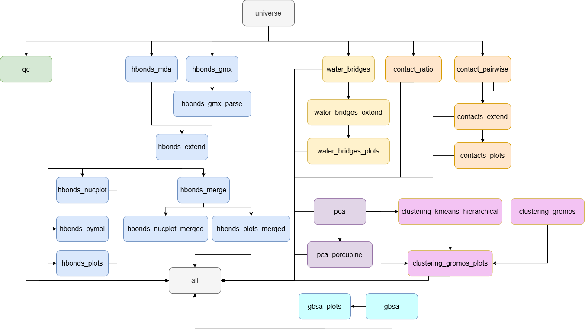

Examples:
```
python -m scripts.main --params <params.yml path> --analysis --rules qc

python -m scripts.main --params <params.yml path> --analysis --rules hbonds contacts

python -m scripts.main --params <params.yml path> --analysis --rules pca clust

python -m scripts.main --params <params.yml path> --analysis --rules gbsa
```

Occasionally, if snakemake runs into an error during the analysis and it crashes, it will lock the directories it was working with, resulting in a recurrent error when the command is rerun. If this happens, verify that no parallel snakemake analysis is running on the locked directory or files, and unlock it with the following command:

```
python -m scripts.main --params <params.yml path> --analysis --rules <rules> --unlock
```

If the error persists, try removing the subdirectory with the analysis results that crashed, in case incomplete files are causing the error.

The following sections include a detailed explanation of the analysis tools included in IMDIA, their most relevant outputs, and interpretation. To showcase their outputs, the case of the DNA-binding domain (DBD) of the human androgen receptor bound to DNA is used as an example.

These are the results of running the hydrogen bond analysis with the parameters ```group1 : Protein``` and ```group2 : DNA``` in ```params.yml```. To instead analyze the dymerization interactions bewteen chain A and chain B of the protein, use ```group1 : A``` and ```group2 : B```. These parameters determine the interactions analyzed by the rule sets for hydrogen bonds (```hbonds```), water bridges (```wb```), contacts (```contacts```) and predicted free binding energy (```gbsa```).


### Quality control: RMSD, RMSF and radius of gyration

Quality control analysis is performed with the ```MDAnalysis.analysis``` module. 

Root mean square deviation (RMSD) quantifies the deviation of the structure from the reference structure over time. It is used as a measure of structural stability, indicating when, if at all, the system reaches a steady conformation with a consistent deviation from the reference structure over time. Taken the difference in position between an atom i at  time t of the simulation and in the reference structure (time 0), the square root of the mean of this squared difference equals the RMSD.

${RMSD}\left(\text{t}\right) = \sqrt{ \frac{1}{\mathrm{N}} \sum_{\mathrm{i}=1}^{\mathrm{N}} {\left| r_{i,t} - r_{i,0}\right|}^{2} }$

The radius of gyration represents how the atoms are arranged around a center of mass, and it is interpreted as a measure of compactness in each spatial axis. In systems without dramatic conformational changes, it is expected to remain mostly constant. This measurement is also plotted against RMSD to characterize the number of stable conformations.

Root mean square fluctuation (RMSF) quantifies the deviation of each particle from its average position over time, helping to identify the regions with greater mobility or flexibility, where fluctuation is higher. These flexible regions typically correspond to loops or terminal regions.

${RMSF}=\sqrt{\frac{1}{{\mathrm{\tau }}_{run}}\sum_{t=t_{initial}}^{t=t_{final}} {\left|\left(r\left(t\right)-{\left\langle r\left(t\right)\right\rangle }_{t}\right)\right|}^{2}}$

**Command to run the QC set of rules**

```
python -m scripts.main --params <params.yml path> --analysis --rules qc
```

**Outputs of the QC set of rules**

```rmsd.csv```

RMSD values across time. Columns and example values:

Time (ns) | Backbone | C-alphas | Protein 
:----| :----- | :----- | :-----
0.0 | 4.527212746405996e-07 | 0.0 | 2.0425459712892502e-08


```rmsd.png```

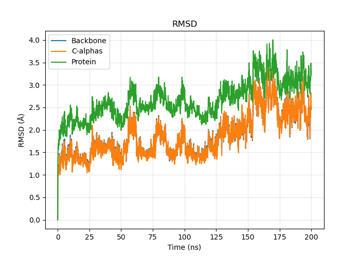


```rmsd_cats.png```

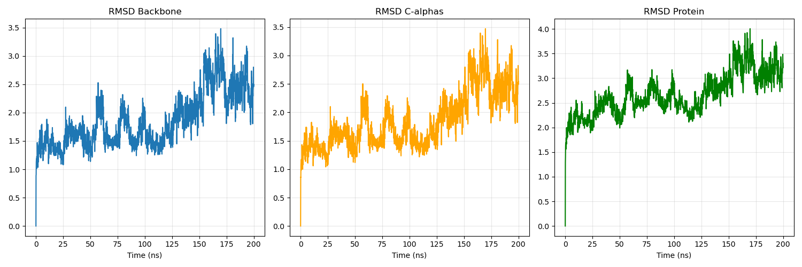

```rmsd_bb.png```

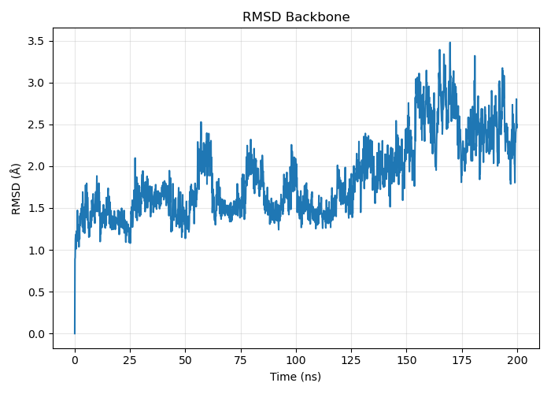


```radius_axis.csv```

Radius of gyration per-axis across time. Columns and example values:

Frame | all | x-axis | y-axis | z-axis
:----| :----- | :----- | :----- | :-----
0 | 17.024509140518564 | 14.147587793739241 | 14.691711078696477 | 12.793248537793204


```radius_axis.png```

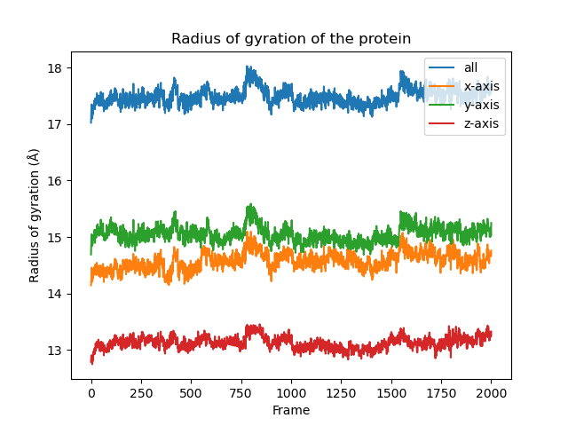

```radius_rmsd.png```

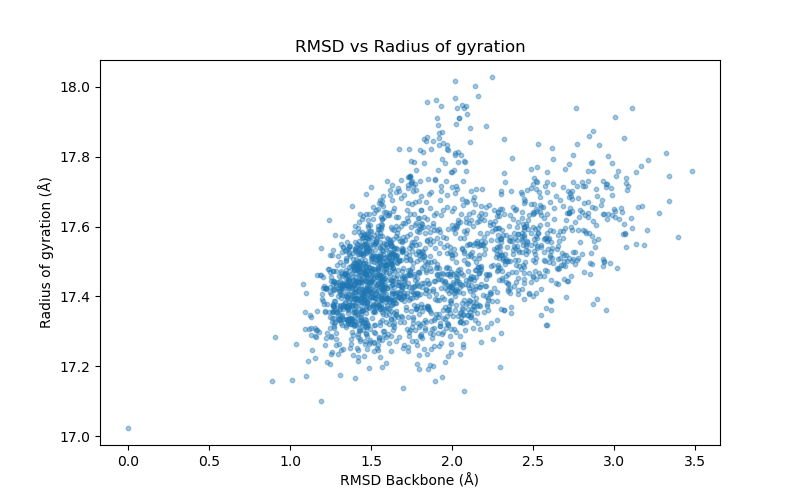

```rmsf_prot.csv```

RMSF per protein chain and residue. Columns and example values:

Residue | Chain | RMSF | Residue | Chain | RMSF
:----| :----- | :----- | :----- | :----- | :-----
539 | A | 3.1007973387268377 | 539 | B | 4.2933019159701225

```rmsf_prot.png```

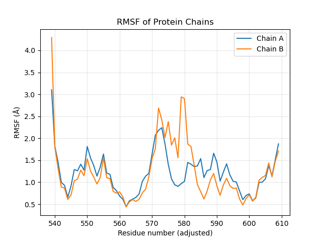

```rmsf_chaingroups.png```

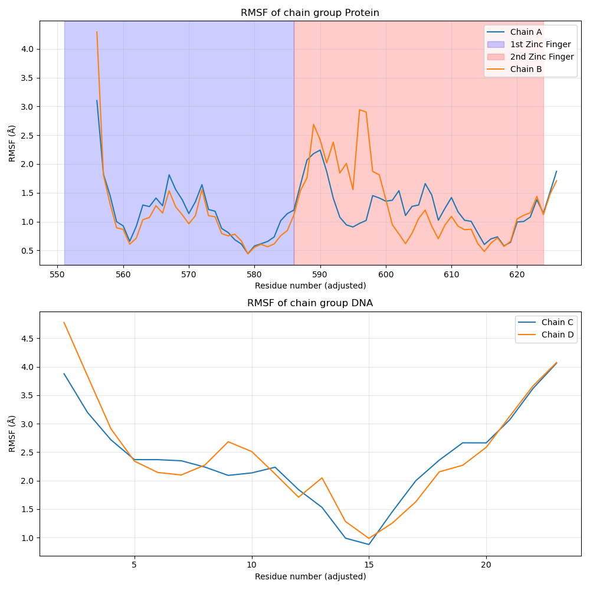

Lines are colored by chain. Colored shaded areas represent the protein domains as indicated in the input parameter file. 


If the system contains DNA, and ```dna: True``` is in the ```params.yml``` parameter file, two additional files are created:

```rmsf_dna.csv```

RMSF per DNA chain and residue. Columns and example values:

Residue | Chain | RMSF | Residue | Chain | RMSF
:----| :----- | :----- | :----- | :----- | :-----
2 | C | 3.8766089346163626 | 2 | D | 4.7759227727541695


```rmsf_dna.png```

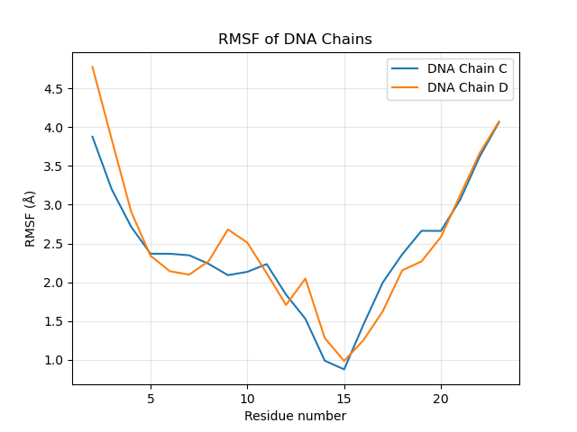


### Principal component analysis (PCA)

Principal component analysis is a linear dimensionality reduction technique that identifies directions of maximum variance in the form of eigenvectors, or principal components (PCs). In molecular dynamics, it is used to extract the dominant motions within a trajectory, reducing noise and increasing interpretability. These motions commonly have the largest amplitude and lowest speed, often corresponding to biologically relevant conformational changes, as opposed to less significant movements that add noise to the trajectory. Beyond highlighting functional motions, PCA provides insight into flexibility regions and stable states.

PCA is computed with the ```gmx covar``` GROMACS function and processed with ```gmx anaeig```.

**Command to run the PCA set of rules**

```
python -m scripts.main --params <params.yml path> --analysis --rules pca
```

**Outputs of the PCA set of rules**

```cum_var.png```

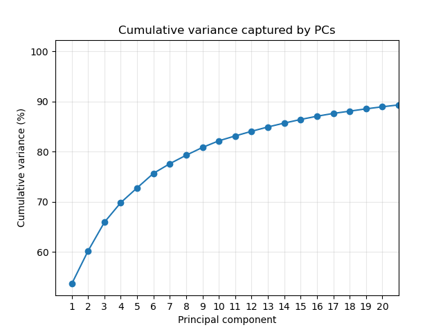

Cumulative variance associated with each incremental principal component, showing how much of the total motion is captured as more PCs are included. It helps determine a target balance between dimensionality reduction and variance explainability, to select the number of components needed to describe the dominant dynamics of the system.

```pc_cosine.png```

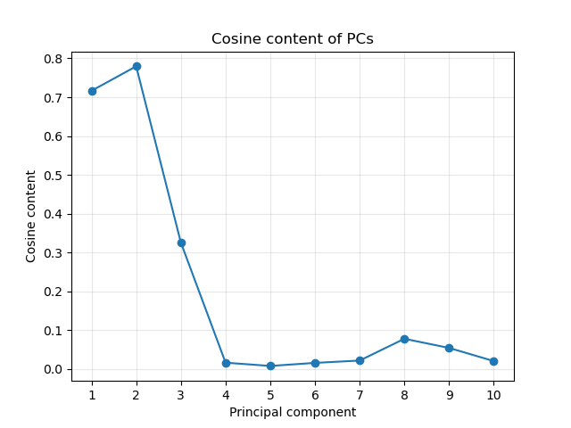

Cosine content against principal components, showing how well structural features are represented along each PC. Higher values indicate stronger contributions.

```pc_pairgrid.png```

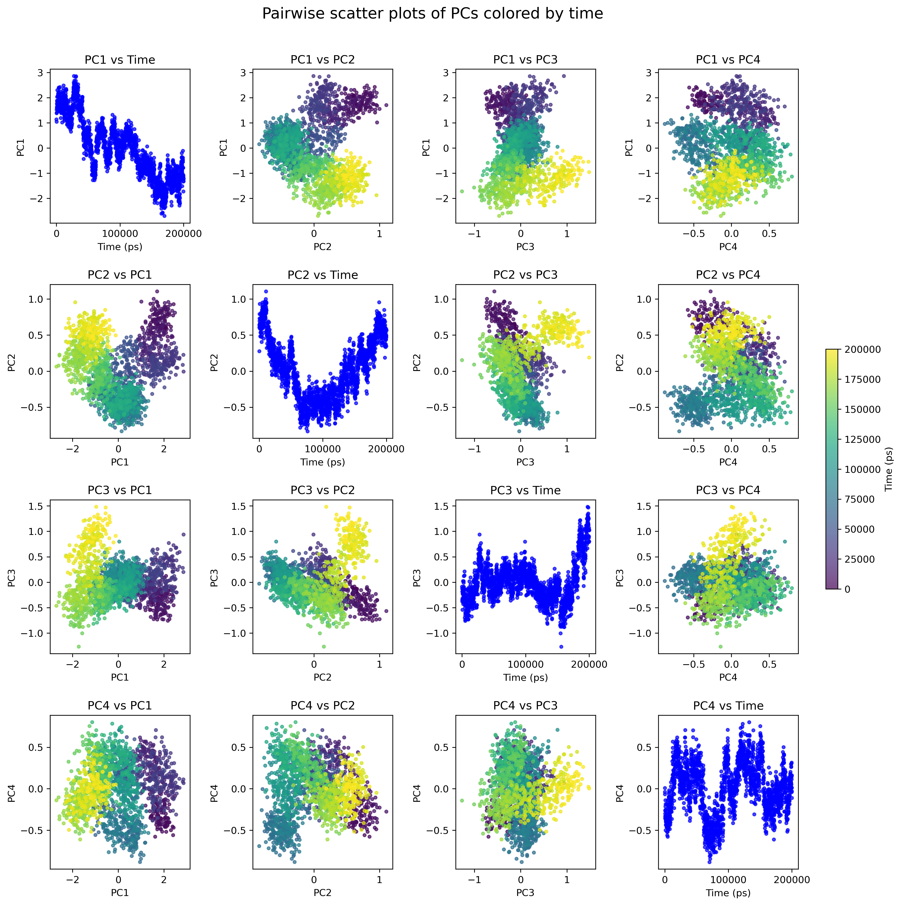

Pairwise scatter plots of principal components colored by simulation time, showing the distribution of conformations in reduced dimensionality space. The color gradient indicates temporal progression along the trajectory. Diagonal plots show the evolution of PC values over time. This helps identify transitions, clustering, and sampling pathways in the conformational landscape.


```pc_rmsf.png```

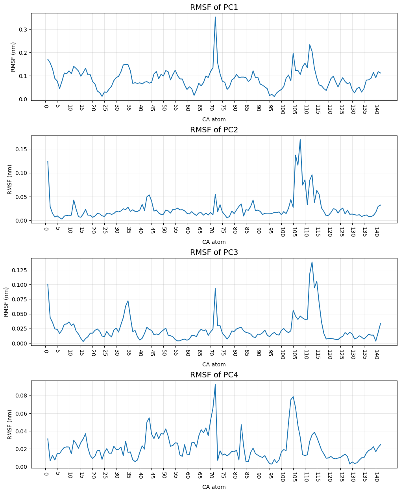

RMSF per Cα atom projected along principal components 1–4. Each panel displays residue-level fluctuations associated with an individual PC, highlighting how different each PC contributes to local flexibility.


```pc1_pc2.png```

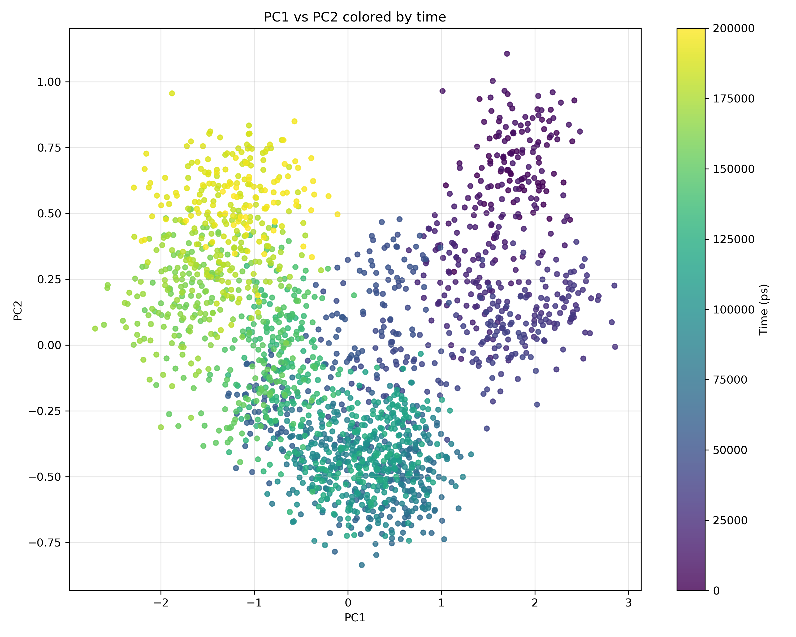

PC1 vs PC2 scatterplot colored by simulation time, showing the distribution of conformations in reduced principal component space. The color gradient reflects temporal progression along the trajectory. This helps reveal clustering and transitions between states.

```porcupine.png```


Porcupine plot of the PC1 projection, showing the dominant motions of the system mapped onto the structure. Cone directions and magnitudes represent the direction and amplitude of atomic displacements along PC1. 

```porcupine.pml```

A dynamically generated PyMOL script to visualize the projection of PC1 as a porcupine plot. This script is used by IMDIA to generate porcupine.png, but it can also be used directly in PyMOL's command line to obtain the same visualization, explore it interactively and obtain better images. The script imports ```extreme1.gro``` and ```modevectors.py```, located in the same ```../analysis/pca``` directory.

```proj_10.csv```

Values of the first 10 PCs across time. This data can be used to explore the PCA in more detail if interesting patterns are observed in the generated plots.

Columns and example values:

Time(ps) | PC1 | PC2 | PC3 | PC4 | PC5 | PC6 | PC7 | PC8 | PC9 | PC10
:----| :--| :-- | :-- | :-- | :-- | :-- | :-- | :-- | :-- | :-- 
0.0 | 1.13489 | 0.27826 | -0.08835 | 0.00813 | -0.37323 | -0.19181 | 0.22578 | -0.312 | -0.2148 | -0.20744


### Clustering
Clustering groups conformations within a trajectory based on similarity, measured with a distance metric, serving to identify representative structures and assess convergence. Additionally, cluster centroids are useful as starting points for complementary runs or targeted analysis. 

IMDIA performs clustering with hierarchical and k-means clustering algorithms, as implemented in the scikit-learn package, using the Euclidean distance metric. The optimal number of clusters is calculated based on the BIC (Bayesian Information Criterion) and the quality of the clustering in terms of cohesion and separation is assessed through the silhouette score. The results are mapped into the plot of the two first principal components. 

**Command to run the clustering set of rules**

```
python -m scripts.main --params <params.yml path> --analysis --rules clust
```

**Outputs of the clustering set of rules**

```pca_clusters_ext.csv```

Cluster assigned to each time point by three clustering algorithms: hierarchical, k-means and gromos. It includes the values of the first 10 PCs at those timepoints. This data can be used to explore the clustering results and the relation to PCA in more detail.

Columns and example values:

Time(ps) | Frame | PC1 | PC2 | PC3 | PC4 | PC5 | PC6 | PC7 | PC8 | PC9 | PC10 | KMeans_Cluster | Hierarchical_Cluster | Gromos_Cluster
:--|:--|:--|:--|:--|:--|:--|:--|:--|:--|:--|:--|:--|:--|:--|
178500.0 | 1786 | -1.21471 | 0.37082 | 0.23428 | -0.20385 | 0.07739 | -0.22587 | -0.12532 | -0.12568 | 0.10129 | -0.07982 | 2 | 1 | 13


```clust_silhouette.png``` 

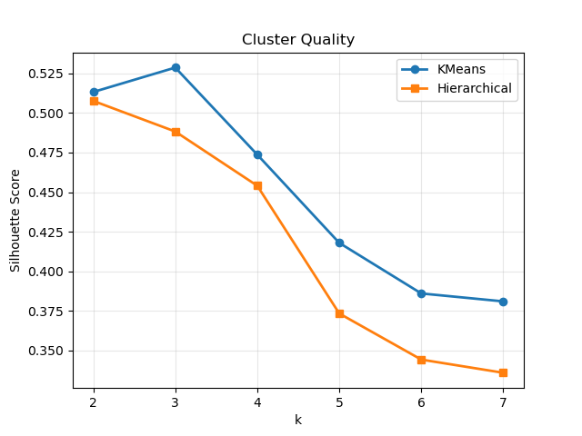

Silhouette score plotted against number of clusters (k), comparing clustering quality for k-means and hierarchical methods. K-means shows a clear peak at k = 3, while hierarchical clustering decreases steadily with no distinct maximum. 

```summary.txt```

Summary of hierarchical and k-means clustering results.

```clust_hierarchical.png```

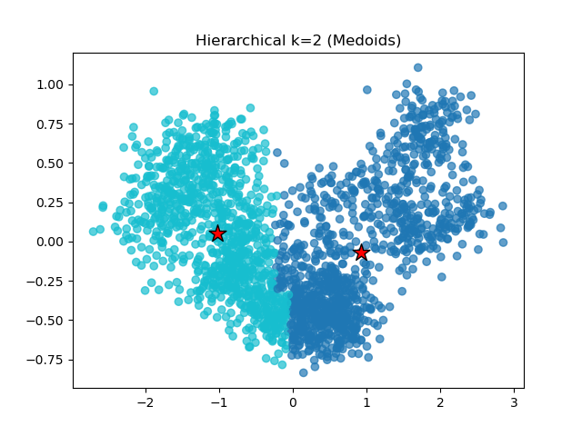

PC1 vs PC2 scatterplot colored by hierarchical clustering assignments, showing the distribution of conformations in reduced space. Cluster medoids are marked as stars to represent representative structures. 

```clust_hierarchical_sizes.png``` 

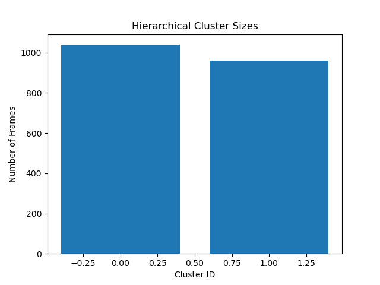

Number of frames per hierarchical cluster, showing the population of each identified state. 

```clust_hierarchical_time.png```   

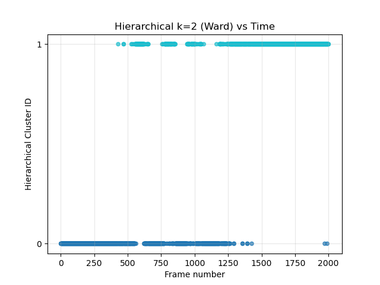

Hierarchical cluster IDs distributed across time frames. Each point indicates the cluster assignment at a given frame, showing state persistence, transitions, and temporal stability of the identified conformational states.

```clust_kmeans.png```     

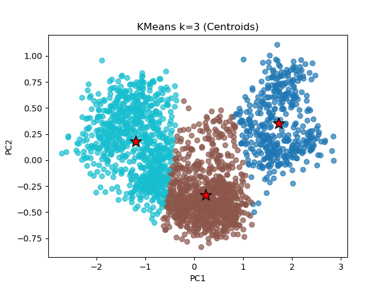


PC1 vs PC2 scatterplot colored by k-means clustering assignments, showing the distribution of conformations in reduced space. Cluster centroids are marked as stars to represent representative structures.

```clust_kmeans_sizes.png``` 

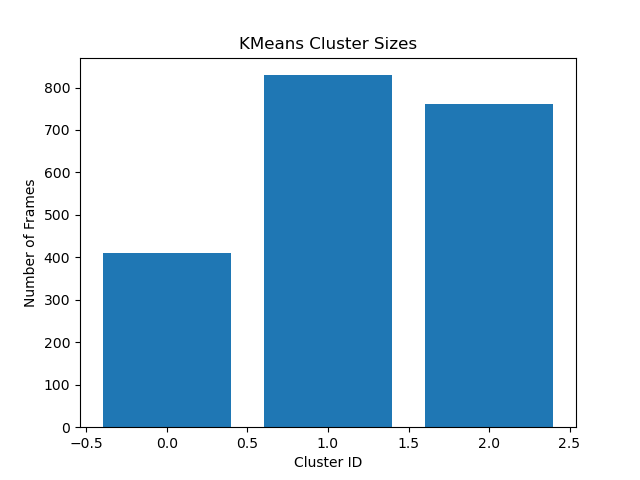


Number of frames per k-means cluster, showing the population of each identified state.

```clust_kmeans_time.png```

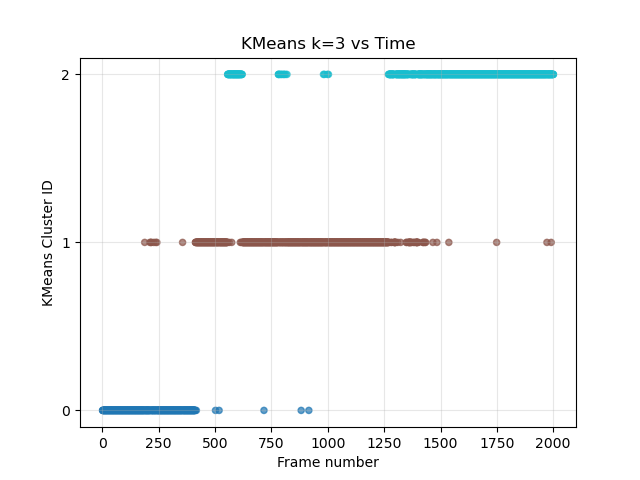

K-means cluster IDs distributed across time frames. Each point indicates the cluster assignment at a given frame, showing state persistence, transitions, and temporal stability of the identified conformational states.
 
```pca_gromos_clusters.png```

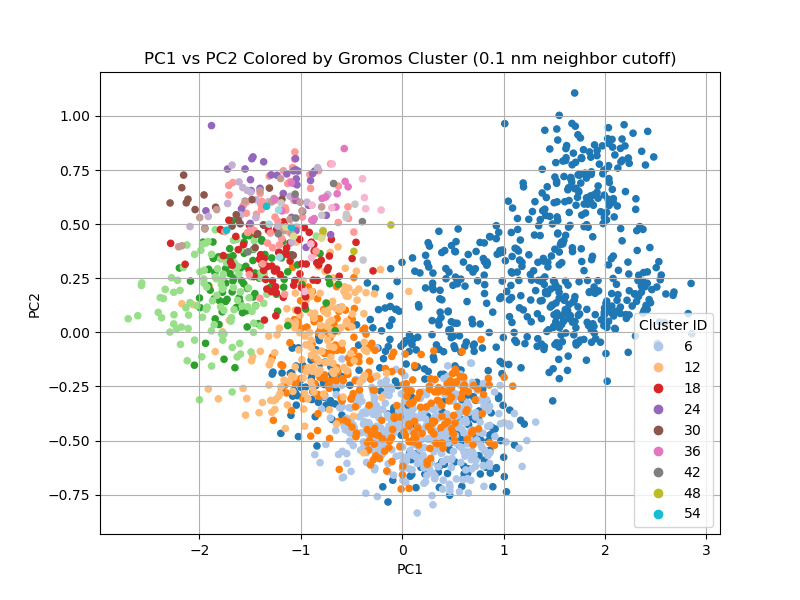

PC1 vs PC2 scatterplot colored by GROMOS clustering assignments using a 0.1 nm neighbor cutoff, showing the distribution of conformations in reduced space. 

```pca_gromos_clusters_top10.png```

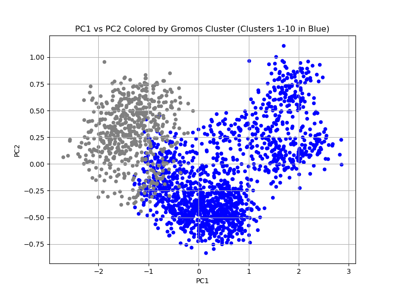

PC1 vs PC2 scatterplot with the frames assigned to the ten most populated GROMOS clusters colored blue. 


```gromos_rmsd_dist.png```  

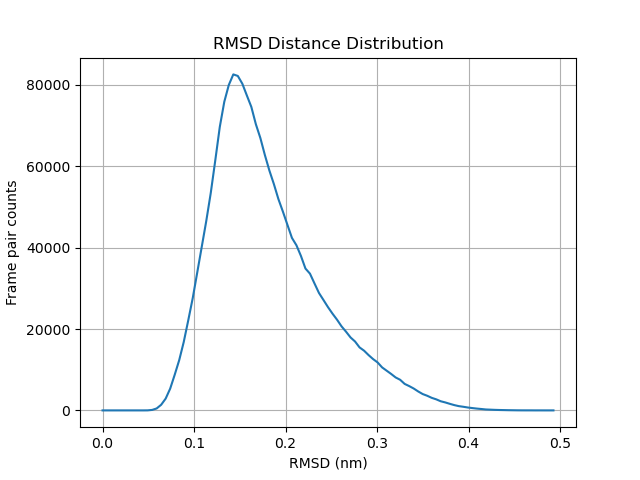

RMSD distance versus frame pair counts, showing the distribution of structural differences across all frame pairs. The bell-shaped distribution peaking at ~0.15 nm indicates that most conformations are moderately similar, with fewer very close or highly distinct structures. In the context of GROMOS clustering, a cutoff below the peak (e.g., 0.1 nm) selects only closely related neighbors, leading to smaller, more specific clusters, while higher cutoffs would merge more conformations into larger clusters.

```gromos_clusters_freq.png```  

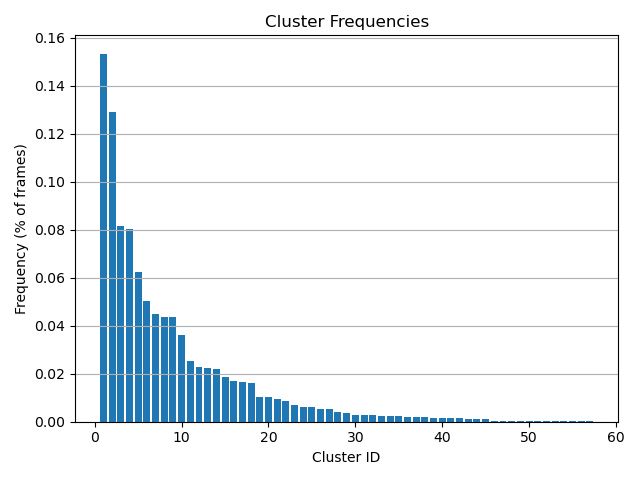

GROMOS cluster frequencies plotted as a percentage of frames versus cluster ID, showing the relative population of each cluster. 

```gromos_clusters.png``` 

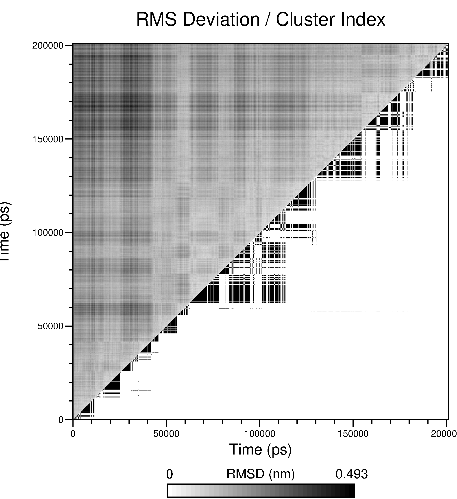

Pairwise RMSD values across time frames. Each cell reflects structural similarity between two frames, with the upper triangle showing continuous RMSD values and the lower triangle indicating cluster membership, overall showing state persistence, transitions, and temporal stability of conformational states. 


### Hydrogen bond analysis
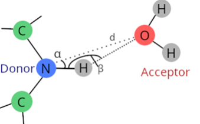

The parameters defining hydrogen bond geometry. d: distance. α: hydrogen-donor-acceptor angle. β: donor-hydrogen-acceptor angle.

Module ```MDAnalysis.analysis.hydrogenbonds.hbond_analysis``` from MD analysis and function ```gmx hbond``` from GROMACS are used to analyze the last 100 ns of the MD trajectory and calculate, for each frame, the detected hydrogen bonds. For the results of the two tools to be valid for aggregation, comparable parameters are used: cutoff distance between donor and acceptor of 3.5 Å, hydrogen–donor–acceptor angle (α) cutoff of 30° in GROMACS, and donor–hydrogen–acceptor angle (β) cutoff of 120º in MDAnalysis.

**Command to run the hydrogen bond analysis set of rules**

```
python -m scripts.main --params <params.yml path> --analysis --rules hbonds
```

**Outputs of the hydrogen bond analysis set of rules**

By default, the hydrogen bond prediction tools used by IMDIA, as determined by the ```params.yml``` parameter ```methods_hbonds: [mda, gmx]```, are MD Analysis and GROMACS, as explained above. For each of these methods, IMDIA generates the following files:

- ```hbonds_{method}_parsed.csv```
- ```hbonds_{method}_ext.csv```
- ```hbonds_{method}_perframe.png```
- ```hbonds_{method}_pergroup.png```
- ```hbonds_{method}_heatmap.png```
- ```hbonds_{method}_heatmap_base.png```
- ```hbonds_{method}_pymol.txt```
- ```hbonds_{method}_nucplot.png```

Additionally, if "Protein" is one of the interaction groups, it generates:
- ```hbonds_{method}_protein_perchain.png```

And, if "DNA" is in one of the interaction groups, it generates:
- ```hbonds_{method}_dna_perchain.png```

The results of the different methods are then aggregated, generating the following outputs:

```hbondsmerged_ext.csv```

Following the computation of predicted hydrogen bonds, the results are extended by mapping the donor and acceptor atom IDs to the reference PDB structure, extracting atom names, residue names, residue numbers and chain identifiers. Protein atoms are mapped to the corresponding domains while DNA atoms, if present, are associated with either the backbone or bases.

Columns and example values:

donor | hydrogen | acceptor | count | frame% | donor_res_name | donor_res_num | donor_atom_name | donor_chain | acceptor_res_name | acceptor_res_num | acceptor_atom_name | acceptor_chain | donor_type | acceptor_type | donor_res_num_adjusted | acceptor_res_num_adjusted | donor_group | acceptor_group | donor_section | acceptor_section
:--|:--|:--|:--|:--|:--|:--|:--|:--|:--|:--|:--|:--|:--|:--|:--|:--|:--|:--|:--|:--|
36 | 38 | 2259 | 1 | 7.6923076923076925 | LYS | 2 | NZ | A | DT | 3 | OP1 | C | Protein | DNA | 540 | 3 | Protein | DNA | Domain1 | backbone

```hbondsmerged_heatmap.png```

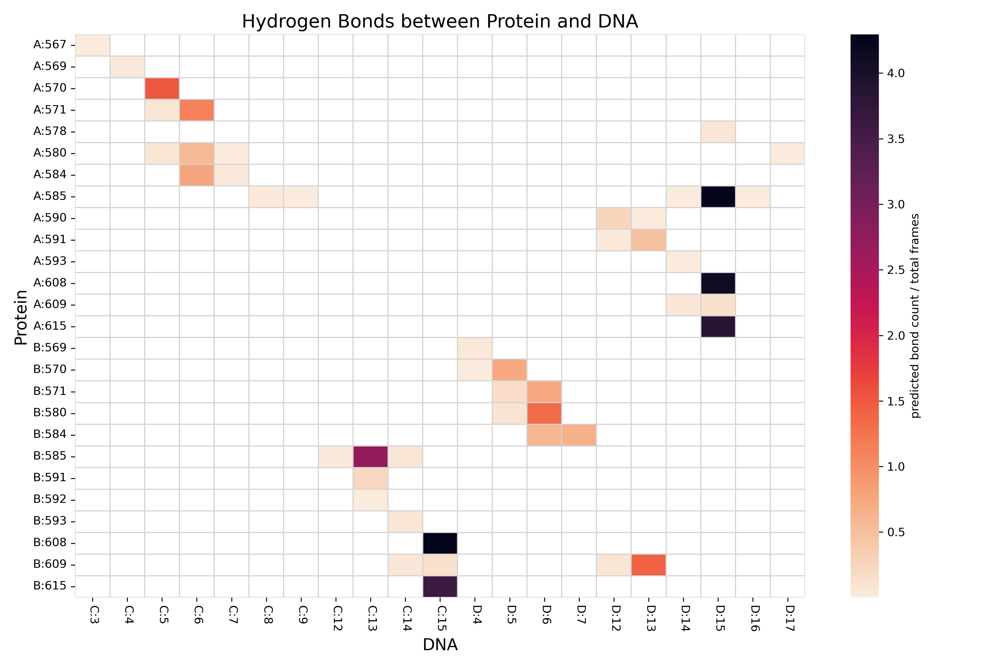

Protein–DNA hydrogen bonds across residues, combining GROMACS and MDAnalysis results. Each cell represents a residue–residue interaction, colored by the fraction of simulation frames in which the hydrogen bond is present, highlighting persistent and transient interactions.

```hbondsmerged_heatmap_base.png```

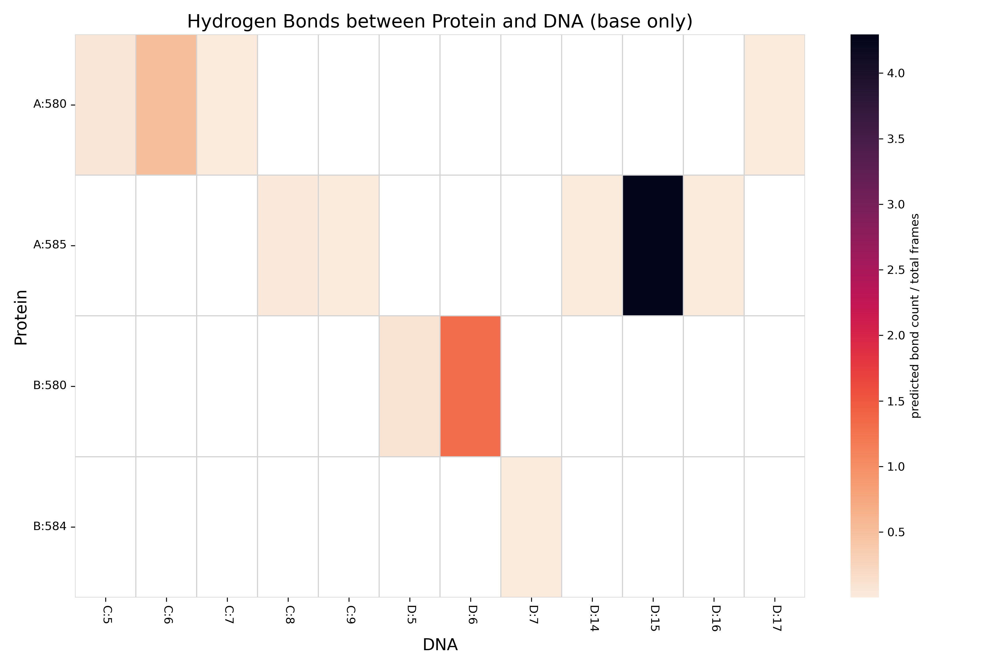

Protein–DNA hydrogen bonds across residue pairs, combining GROMACS and MDAnalysis results, filtered by hydrogen bonds with the DNA bases. Each cell represents a residue–residue interaction, colored by the fraction of simulation frames in which the hydrogen bond is present. Hydrogen bonds formed directly with bases are key to binding specificity.

```hbondsmerged_per_group.png```

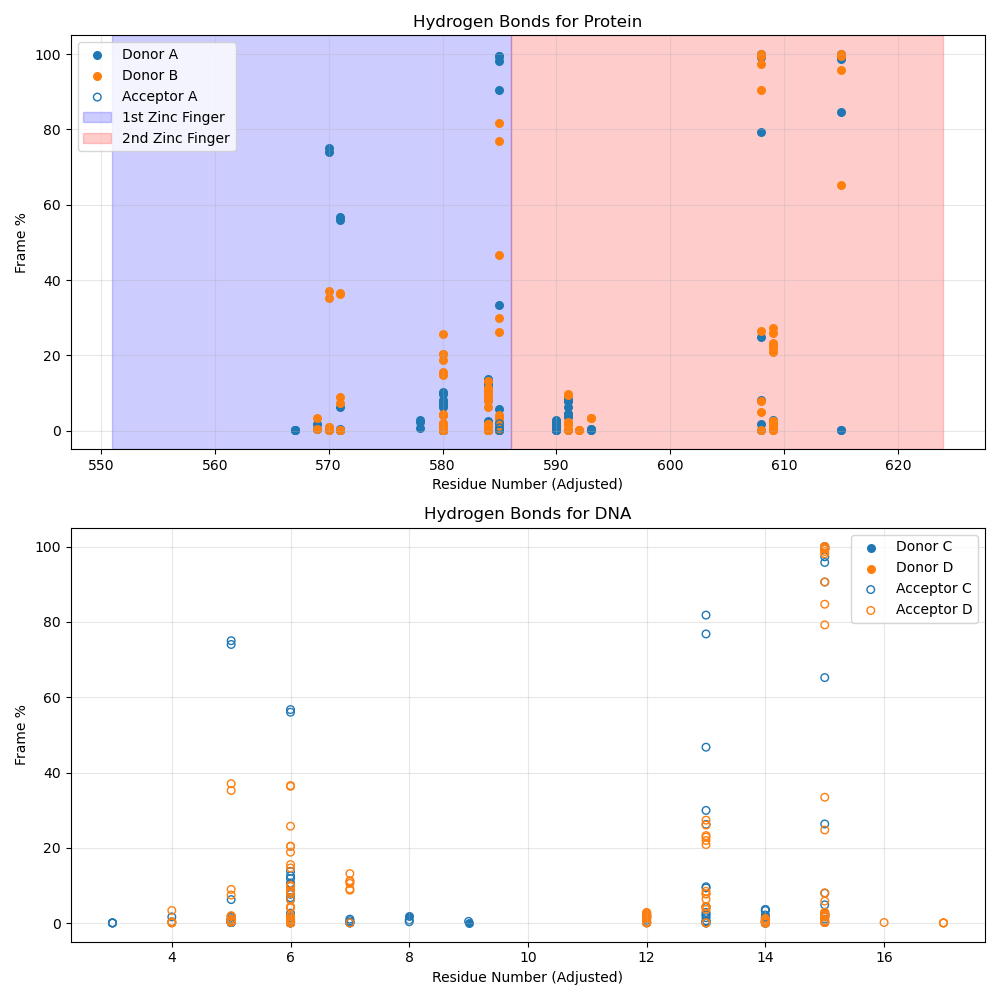

Hydrogen bonds between protein and DNA, combining GROMACS and MDAnalysis results. Each point represents a donor-acceptor pair. The top panel shows protein residues and the bottom panel DNA residues, with points colored by chain and marker style indicating donor (filled) or acceptor (open) roles. The panels are complementary, with donors in one panel forming bonds with acceptors in the other. Shaded regions correspond to protein domains as indicated in the input parameters.

```hbondsmerged_protein_perchain.png```

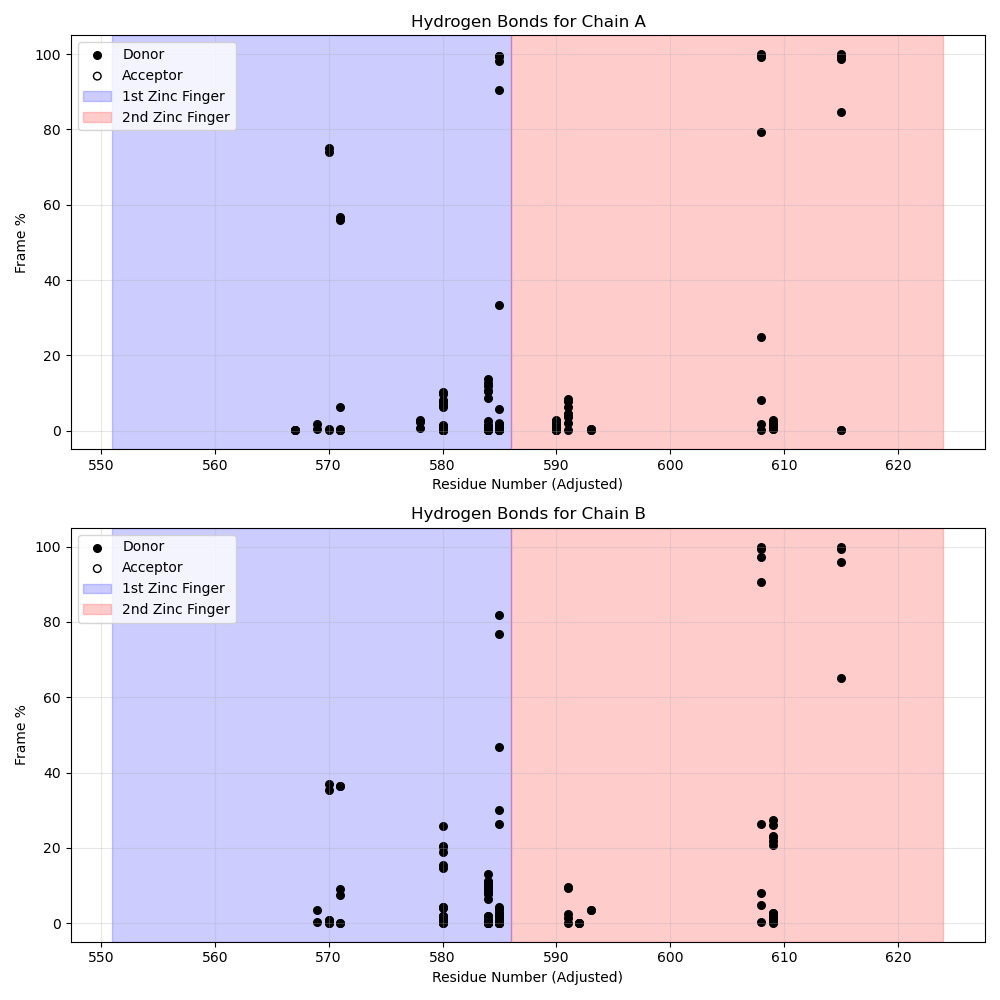

Hydrogen bonds between protein and DNA, combining GROMACS and MDAnalysis results, per protein chain and residue. Each point represents a donor-acceptor pair, colored by chain and marker style indicating donor (filled) or acceptor (open) roles. Shaded regions correspond to protein domains as indicated in the input parameters.

```hbondsmerged_dna_perchain.png```

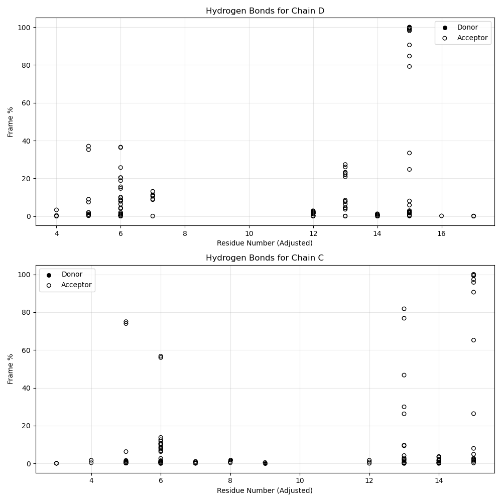

Hydrogen bonds between protein and DNA, combining GROMACS and MDAnalysis results, per DNA chain and residue. Each point represents a donor-acceptor pair, colored by chain and marker style indicating donor (filled) or acceptor (open) roles.

```hbondsmerged_nucplot.png```

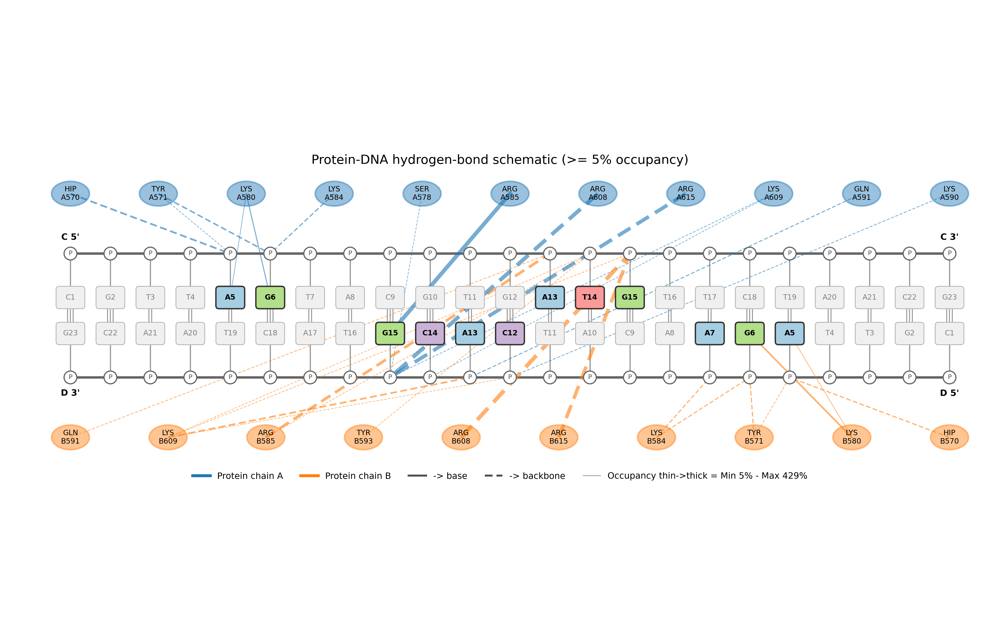

Hydrogen-bond schematic between protein and DNA, combining GROMACS and MDAnalysis results, mapped onto the full DNA duplex. Nucleotides pairs are shown as an antiparallel ladder; highlighted bases indicate residues involved in at least one protein contact above the occupancy threshold. Lines connect protein residues to the exact base or backbone atom they hydrogen-bond to, colored by protein chain. Line style distinguishes base (solid) from backbone (dashed) bonds. Line width scales with occupancy.

The code to generate this plot has been adapted from NUCPLOT (https://github.com/RomanLas/NUCPLOT).


```hbondsmerged_pymol.txt```

Dynamically generated PyMOL commands that highlight the pairs of donors and acceptors predicted to form hydrogen bonds in more than 10% of the analyzed frames. Use it in PyMOL's command line to obtain this visualization similar to the one below, and explore it interactively.

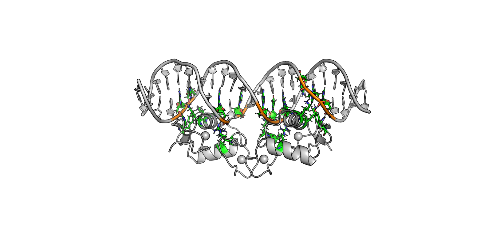


### Water bridge analysis

Module ```MDAnalysis.analysis.hydrogenbonds.WaterBridgeAnalysis``` from MD analysis is used to study water bridges. The default parameters are used: donor–acceptor distance of 3.0 Å, 120° angle cutoff and a bridge order of one, meaning a single water molecule may act as intermediary. The atoms bonded to the water molecule can act as two donors, two acceptors or a donor and an acceptor. The water bridges between the two selections of interest are computed, and bonds within them are omitted. The analysis is run in the last 100 ns of the simulation.

**Command to run the water bridge analysis set of rules**

```
python -m scripts.main --params <params.yml path> --analysis --rules wb
```

**Outputs of the water bridge analysis set of rules**

```waterbridges_ext.csv```

CSV file listing the triplets of atoms forming a water bridge, including their residue numbers and names, distance and angle. Each entry is associated with a timeframe.

Columns and example values:

time | sele1_index | sele2_index | sele1_resnm | sele1_resid | sele1_atom | sele2_resnm | sele2_resid | sele2_atom | distance | angle | 
:--|:--|:--|:--|:--|:--|:--|:--|:--|:--|:--|
400.0 | 1912 | 22946 | LYS | 54 | HZ1 | WAT | 4901 | H2 | 3.4972313167641813 | 136.53447401441616

```waterbridges_per_frame.png```

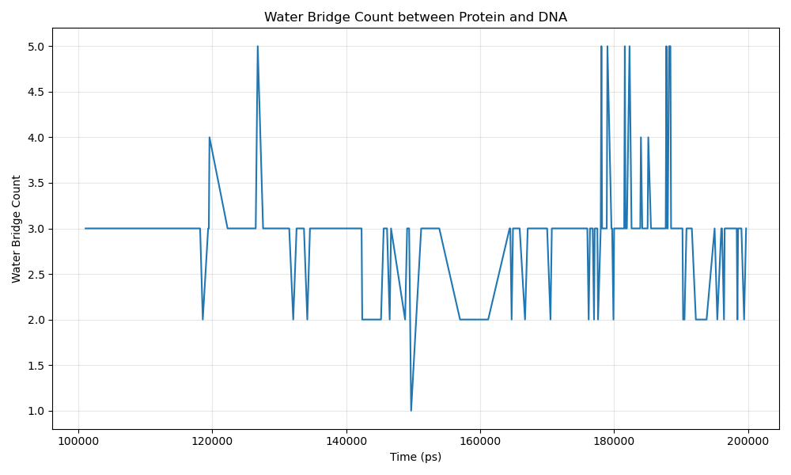

Time evolution of water-mediated interactions between protein and DNA, showing fluctuations in the solvent contribution to the stability of the complex.


```water_bridges_per_chain.png```

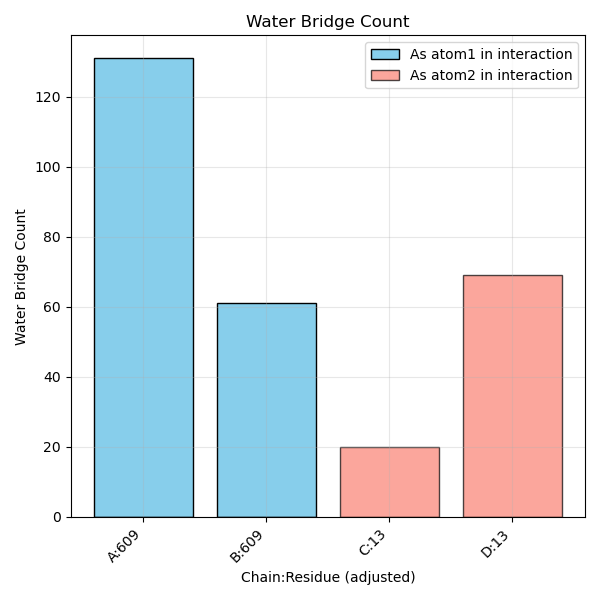


Protein–DNA water bridge counts by chain and residue. Each bar represents the number of water-mediated interactions for a given residue, colored by the role of the participating atoms.


### Contact analysis

IMDIA calls two MD Analysis modules to perform the analysis: ```MDAnalysis.analysis.contacts``` and ```MDAnalysis.lib.distances```. The analysis is run on the last 100 ns.

The first analysis counts the number of contacts within a radius of 5 Å at each time frame and returns the fraction of these contacts (termed native contacts) present in the reference structure. This metric provides insight into stability and conformational changes.

The second analysis builds a distance array with the pairwise distances between the atoms in the two selections, across time, excluding distances greater than 5 Å. To simplify the analysis, contacts are considered at a residue level and not an atom level. In other words, the 5 Å cutoff is applied on an atom pair level, but in subsequent steps, these atoms are identified by their residues.

**Command to run the contact analysis set of rules**

```
python -m scripts.main --params <params.yml path> --analysis --rules contacts
```

**Outputs of the contact analysis set of rules**

```contacts_timeseries.csv```

Fraction of native contacts present at each frame.

Columns and example values:

 -  | -
:-- | :--
1.0 | 0.25088235294117645
2.0 | 0.30323529411764705
3.0 | 0.265
4.0 | 0.20794117647058824

```contacts_timeseries.png```

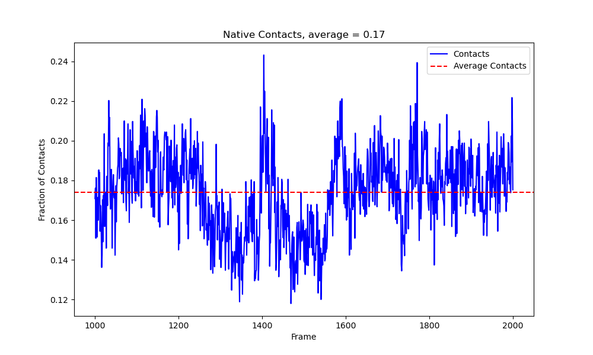

Fraction of contacts between protein and DNA within a radius of 5 Å  that are also present in the reference structure, across simulation time. This metric provides insight into stability and conformational changes.

frame | sele1_resid | sele1_resnm | sele1_chain | sele2_resid | sele2_resnm | sele2_chain | distance
:-- |:-- |:-- |:-- |:-- |:-- |:-- |:-- |
122 | 23 | SER | B | 15 | DG | C | 3.5848300879810786

```contacts_pairs_ext.csv```

Count of contacts with a distance below 5 Å between residues in the two selections. The CVS includes residue names, numbers and chains for identification, as well as the average distance of these contacts and the ratio of frames in which they are present.

Columns and example values:

sele1_resnm | sele1_resid_adj | sele1_chain | sele2_resnm | sele2_resid_adj | sele2_chain | count | distance_avg | ratio |
:-- |:-- |:-- |:-- |:-- |:-- |:-- |:-- |:-- |
ALA | 549 | A | DT | 3 | C | 2 | 4.872682469790483 | 0.001

```contacts_hist_distance.png```

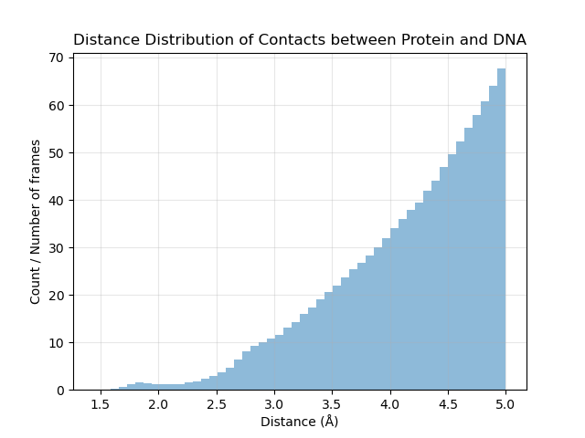

Distribution of protein–DNA contact distances. Counts are normalized by the number of frames, showing an increasing trend toward the 5 Å cutoff, reflecting the higher number of contacts detected at larger distances.

```contacts_hist_time.png```

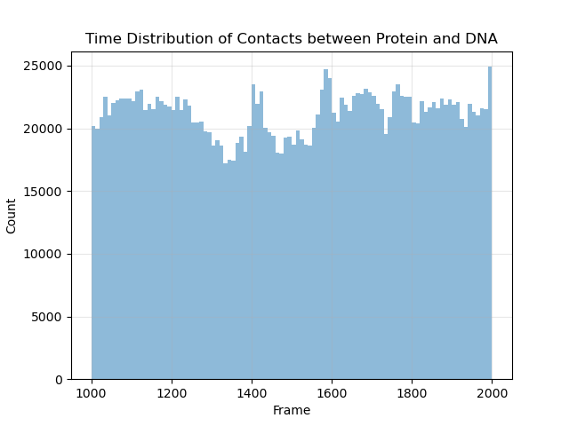

Number of protein–DNA contacts across simulation frames. The total contact count per frame illustrates the temporal fluctuations and overall interaction stability.

```contacts_heatmap_count.png```

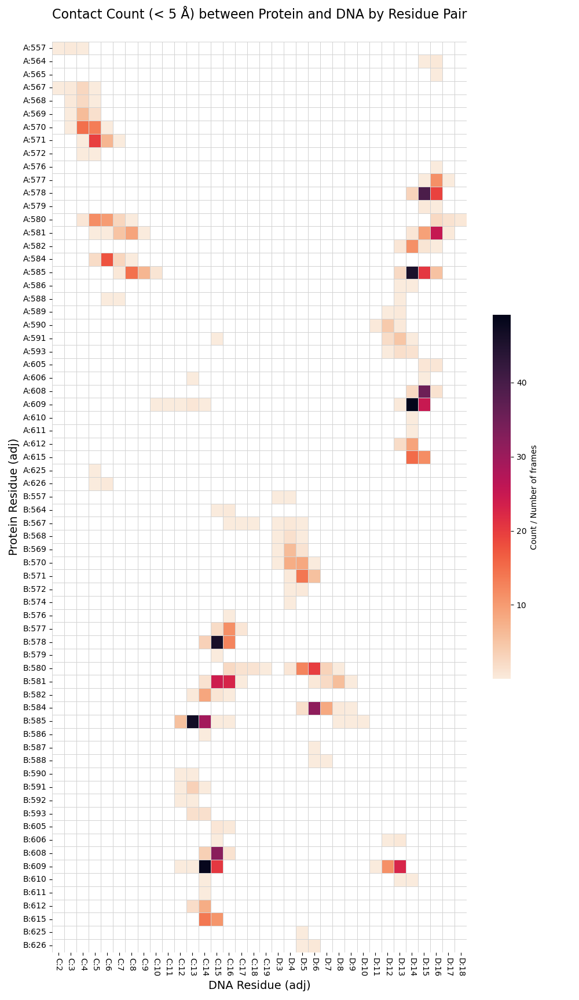

Protein–DNA contacts (≤5 Å) across residue pairs. Each cell represents a residue–residue interaction, colored by the fraction of frames in which the contact is observed, with darker values indicating more persistent interactions.

```contacts_heatmap_distance.png```

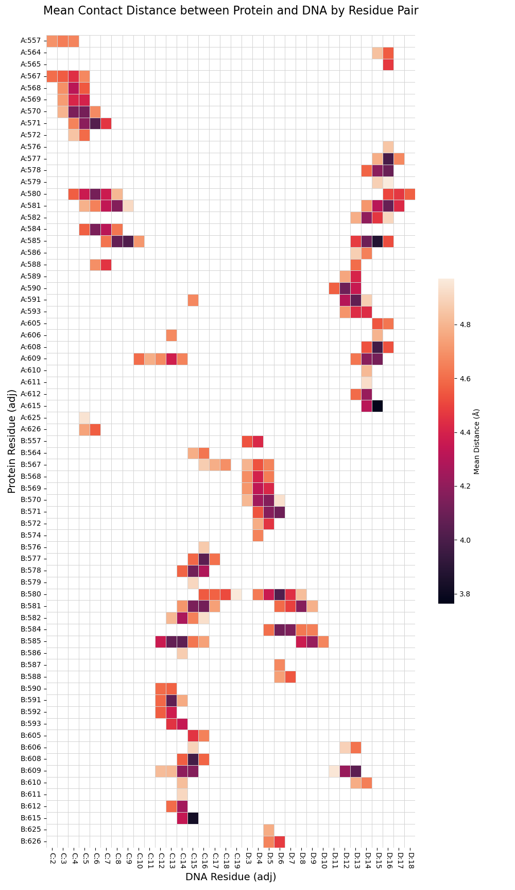

Mean protein–DNA contact distances (≤5 Å) across residue pairs. Each cell represents a residue–residue interaction, colored by the average distance over frames, with darker values indicating closer and more stable contacts.

```contacts_bubble.png```


Protein–DNA contacts (≤5 Å) across residue pairs. Circle size reflects the fraction of frames in which each contact occurs, while color indicates mean contact distance, with darker shades representing closer interactions. Larger, darker circles highlight the most persistent and proximal contacts.

```contacts_bubble_filtered.png```

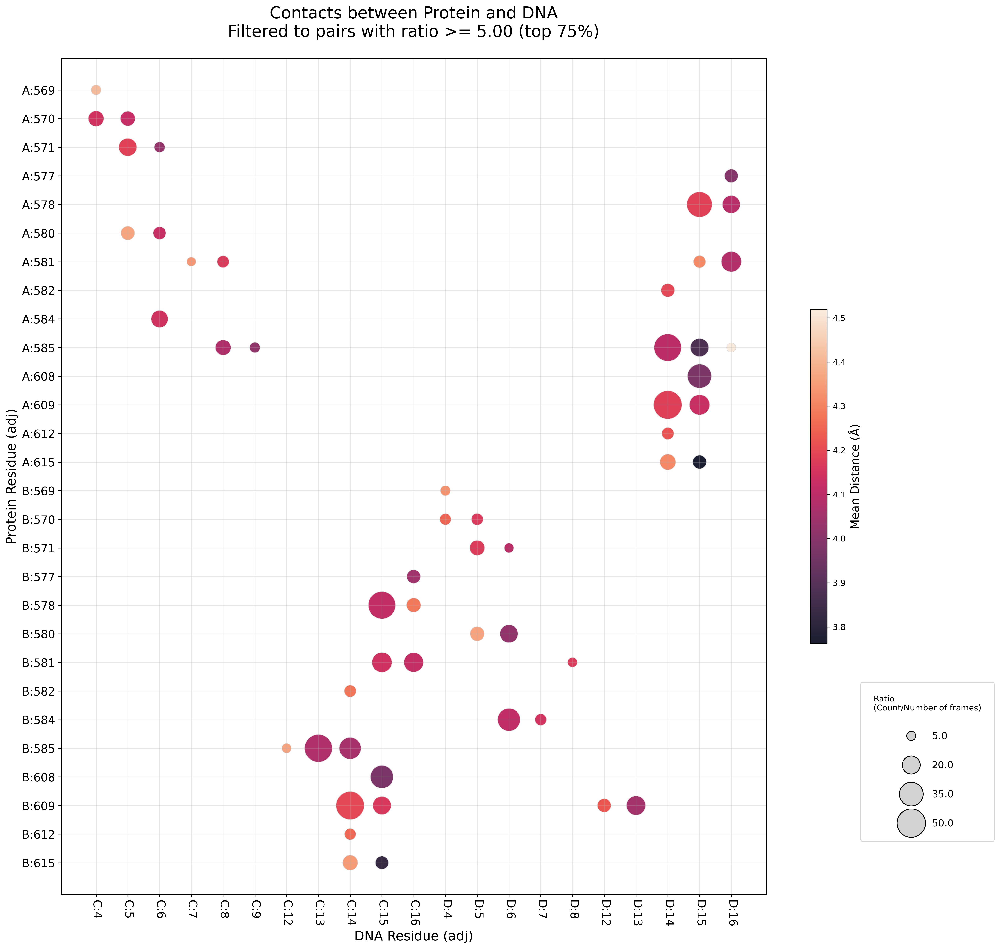

Protein–DNA contacts (≤5 Å) filtered to high-frequency interactions (top 75%). Circle size reflects the fraction of frames in which each contact occurs, and color indicates mean distance, with darker shades representing closer interactions. Larger, darker circles highlight the most persistent and proximal contacts.


### MM/GBSA. Predicted free binding energy

The software gmx MMPBSA is used to perform MM/GBSA (Molecular Mechanics/Generalized Born Surface Area) free binding energy calculations on the last 100 ns of the MD simulation results. The input parameters are specified in mmpbsa.in. The estimated free binding energy and its components across time are reported for the whole complex as well as on a per-residue basis. The results are saved in both .dat format, compatible with the gmx MMPBSA visualization GUI, and in CSV format to facilitate further processing and analysis. 

**Command to run GBSA set of rules**

```
python -m scripts.main --params <params.yml path> --analysis --rules gbsa
```

**Outputs of the GBSA set of rules**

```FINAL_ENERGY.csv```

Total predicted free binding energy per frame and its component breakdown. 

Columns and example values:

Frame # | BOND | ANGLE | DIHED | VDWAALS | EEL | 1-4 VDW | 1-4 EEL | EGB | ESURF | GGAS | GSOLV | TOTAL | 
:--|:--|:--|:--|:--|:--|:--|:--|:--|:--|:--|:--|:--|
1 | 818.16 | 1789.4 | 1801.39 | -1768.86 | -859.28 | 906.25 | 112.72 | -1225.9 | 89.18 | 2799.78 | -1136.72 | 1663.06
2 | 783.3 | 1884.88 | 1755.09 | -1773.09 | -875.86 | 905.86 | 116.66 | -1214.68 | 91.64 | 2796.83 | -1123.04 | 1673.8
3 | 826.38 | 1940.3 | 1743.52 | -1773.13 | -842.25 | 868.01 | 111.59 | -1242.71 | 91.43 | 2874.43 | -1151.28 | 1723.15
4 | 808.55 | 1907.49 | 1750.19 | -1806.64 | -822.81 | 876.1 | 113.61 | -1259.68 | 93.29 | 2826.5 | -1166.4 | 1660.1
5 | 775.27 | 1897.15 | 1774.16 | -1791.38 | -826.93 | 907.33 | 107.74 | -1247.33 | 94.36 | 2843.34 | -1152.97 | 1690.37
6 | 860.96 | 1858.17 | 1765.95 | -1840.31 | -824.86 | 881.15 | 106.74 | -1245.22 | 92.07 | 2807.8 | -1153.16 | 1654.65

```FINAL_ENERGY_DECOMP.csv```

Total predicted free binding energy per frame and residue and its component breakdown. The residue column follow the formula ```Receptor(R)/Ligand(L):Chain:Residue name:Residue number```.

Columns and example values:

Frame # | Residue | Internal | van der Waals | Electrostatic | Polar Solvation | Non-Polar Solv. | TOTAL
:--|:--|:--|:--|:--|:--|:--|:--|
1 | R:A:ASP:9 | 19.79 | -4.18 | 16.21 | -24.34 | 0.11 | 7.59
1 | R:A:SER:12 | 9.9 | 2.34 | -1.22 | -0.41 | 0.34 | 10.95
1 | R:A:GLY:13 | 4.07 | -1.5 | -0.52 | -0.5 | 0.19 | 1.75
1 | R:A:ALA:14 | 5.4 | -4.47 | 0.66 | -0.68 | 0.31 | 1.22
1 | R:A:HIP:15 | 34.25 | -6.83 | -25.4 | 23.68 | 0.07 | 25.78

```gbsa_full_totalenergy.png```

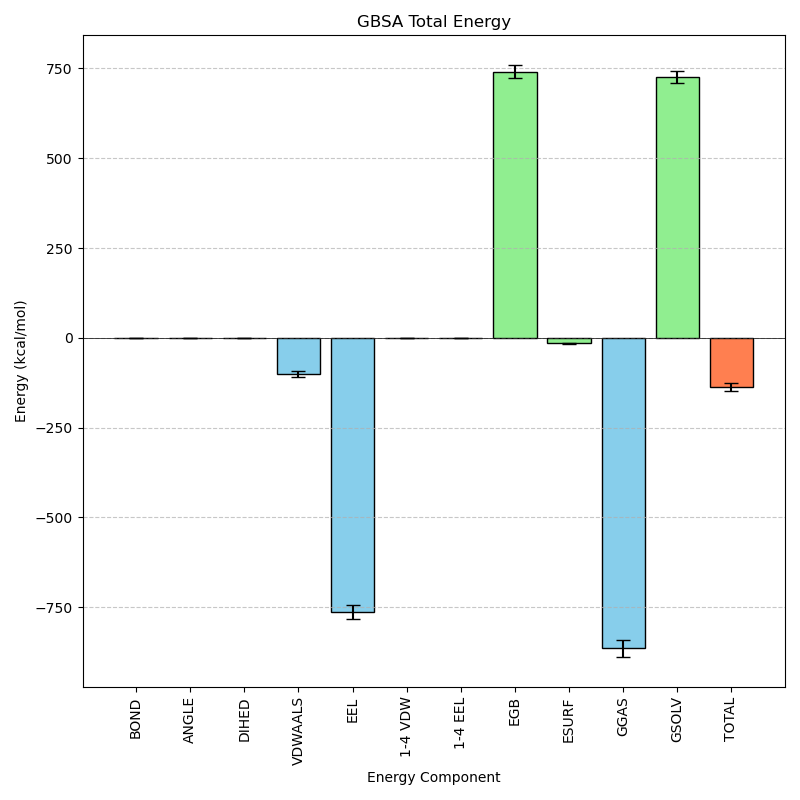

Decomposition of protein–DNA binding free energy into energetic components. Contributions include bonded terms (BOND, ANGLE, DIHED), nonbonded interactions (VDWAALS: van der Waals; EEL: electrostatic; 1–4 VDW/EEL: intramolecular short-range interactions), and solvation terms (EGB: generalized Born energy; ESURF: solvent accessible surface area). Aggregate terms GGAS (gas-phase energy), GSOLV (solvation energy), and TOTAL summarize the overall binding energetics.

```gbsa_res_totalenergy.png```

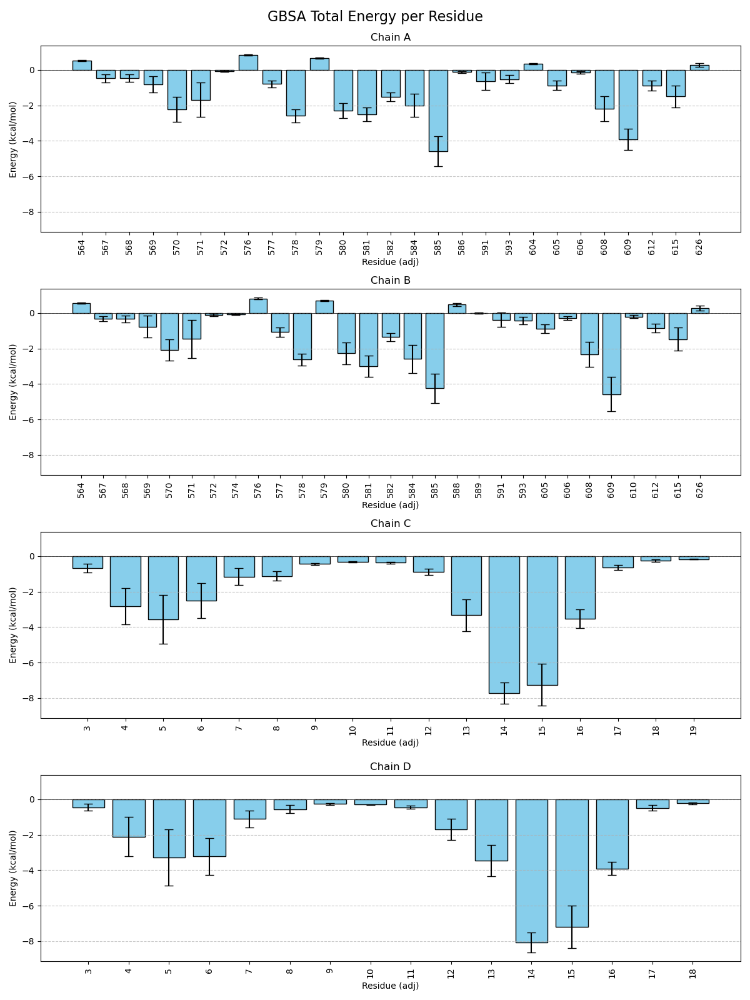

Residue decomposition of protein–DNA total binding free energy per protein and DNA chain, highlighting key residues for the stability.


